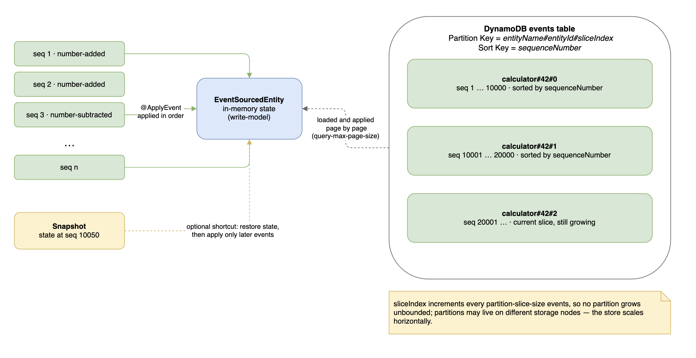
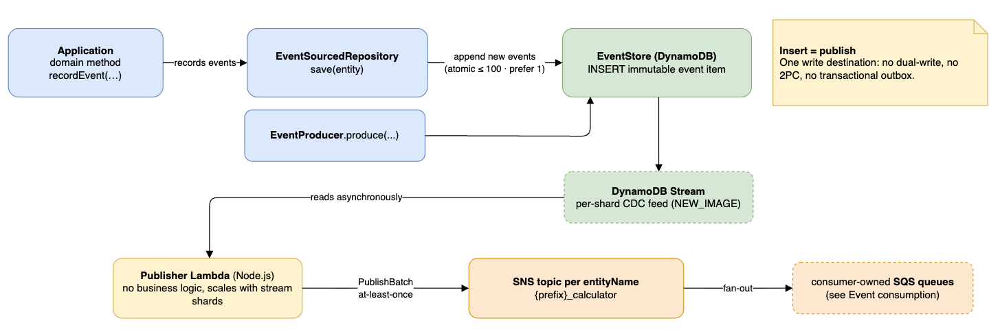
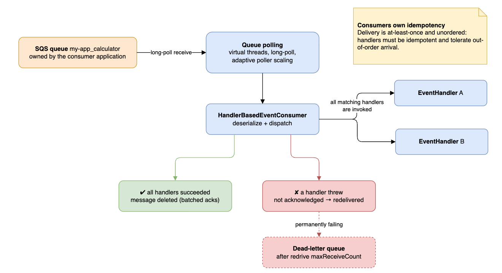
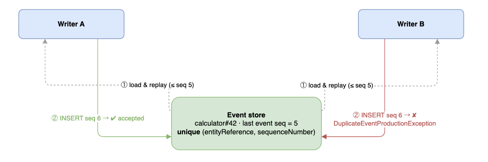
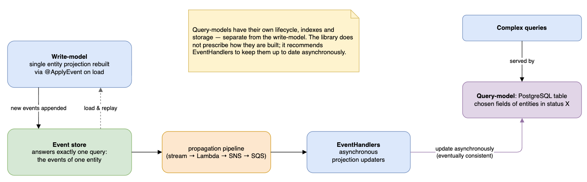

# Design and Architecture

- [Event structure](#event-structure)
- [Event sourcing and storage](#event-sourcing-and-storage)
- [Producing and propagating events](#producing-and-propagating-events)
- [Event consumption](#event-consumption)
- [Optimistic concurrency control](#optimistic-concurrency-control)
- [CQRS](#cqrs-command-query-responsibility-segregation)

Guarantees traded away by this design are listed separately in [Compromises](compromises.md).

## Event structure

```json
{
  "entityReference": {
    "entityName": "calculator",
    "entityId": "1123456"
  },
  "eventName": "number-added",
  "sequenceNumber": 15,
  "timestamp": "2025-10-20T10:20:30.000Z",
  "payload": {
    "number": 101
  }
}
```

`EventType` and its payload are defined by combination of `entityName` and `eventName`. Payload class has to
be [registered](guide/02-events-and-entities.md#register-your-events).

## Event sourcing and storage



1. `EventSourcedEntity` derives its current state from all the events that happened to it.
   See [usage](guide/02-events-and-entities.md#define-an-event-sourced-entity)
2. Each Entity is identified by a `EntityReference`, which is a combination of `entityName` and `entityId`.
3. Each Event recorded on an Entity is identified by a combination of `EntityReference` and `sequenceNumber`.
4. Each Event has its `eventName`, which identifies how it alters state of an entity when applied on it.
5. Events are gaplessly sequenced per each entity starting from `sequenceNumber` 1.
6. `EntityReference` defines a partition where its events are stored.
7. As the framework requires consistency only within a single entity, the underlying database is free to store 
   a partition per entity and shard partitions into different machines.
8. For entities with long histories [Snapshotting](guide/03-repositories-and-snapshots.md#set-up-optional-snapshot-takers)
   can be utilized to avoid loading and re-applying all historic events from the beginning.
9. "Hot" entities with long histories can make a partition where its events are stored too heavy. Adapters may slice
   an entity's partition, e.g. the DynamoDB adapter's
   [partition slicing](aws-reference-implementation.md#partition-slicing-of-the-events-table).

## Producing and propagating events



1. Domain methods on an `EventSourcedEntity` record new `Events`; and when entities are saved in
   `EventSourcedRepository` all newly recorded events are appended to `EventStore`.
   See [usage](guide/03-repositories-and-snapshots.md#set-up-an-event-sourced-repository)
2. It's possible to produce multiple events atomically (up to 100 with AWS DynamoDB) when saving an
   `EventSourcedEntity`, but it's recommended to limit to one event per operation. That saves the database from
   potential duty having to span a transaction across multiple partitions and writer nodes, which is a more complex and
   costly operation.
3. Events that do not belong to an `EventSourcedEntity` can be produced using `EventProducer.produce(...)` interface
   directly.
4. Every produced event is an immutable document inserted into database. Inserting an event *is* publishing it. The
   database's inserts-stream (CDC mechanism) is read by an events-publisher and events are
   eventually propagated to consumers. This way there's no dual-write problem, no 2PC, and no need to maintain a
   [transactional outbox table](https://microservices.io/patterns/data/transactional-outbox.html). The database's
   inserts-stream can be sharded together with the database itself, each shard naturally maintaining a separate stream.
5. In the [reference implementation](aws-reference-implementation.md) `DynamoDB Streams` are read by a `AWS Lambda`
   running on `Node.js` runtime publishing the event messages into an `SNS` topic per entityName.

## Event consumption



1. Event consumption mechanism can be implemented in various ways, but the reference implementation is based on
   queue-polling mechanism provided in corresponding module.
2. Provided reference implementation uses `SQS` queues owned by consumer application and per subscribed topic belonging
   to an entityName.
3. `entityName` and `eventName` are provided as String type `SNS MessageAttributes`, which can be utilized for filtering
   when subscribing SQS queues to SNS topics.
4. Application layer utilizes `HandlerBasedEventConsumer`, which provides possibility to consume events registering
   `EventHandler` implementations. See [usage](guide/04-event-handlers.md).
5. `EventHandlers` are needed to react on interested events or execute a new command.
6. The Event consumption mechanism and EventHandlers are not restricted to events produced by the same application, or
   only to events recorded and produced within `EventSourcedEntity`.
7. Only a successful consumption acknowledges an event message. If `EventHandler` throws an exception, the message is
   not acknowledged, and may be redelivered by message broker. Configure the queue's redrive
   policy and dead-letter queue so a permanently failing message does not retry forever.
8. All matching `EventHandlers` are tried and called upon each event message delivery.
9. Handlers or processes triggered by them must be **idempotent** and tolerant of out-of-order arrival
   (see [Compromise #2](compromises.md#2-at-least-once-unordered-delivery)).
10. Event consumption mechanism is entirely optional, if application does not need to consume events.
11. The queue-polling mechanism scales vertically adapting to the load, performs partial polls in cases if message
    consumption is not uniform across messages, batches deletes, supports graceful shutdown.

## Optimistic concurrency control



1. Only uniqueness constraint and primary key index maintained by the underlying database is
   `(entityReference, sequenceNumber)`.
2. Upon event production a `DuplicateEventProductionException` might be thrown for two reasons both having to do with
   entity modification in parallel or in short span of time:
    1. another `Event` of the same `sequenceNumber` was produced in parallel after the `EventSourcedEntity` was loaded.
    2. an entity was loaded in a stale state without the newest events due to inconsistency between database's reader
       nodes.
3. In case of `DuplicateEventProductionException` the failed operation should be retried from the beginning until it's
   successfully processed or recognized as outdated, and acknowledged in any case.

## CQRS (Command Query Responsibility Segregation)



The event-store structure of events-caravan provides answer to exactly one query: find events of one entity, ordered.
`EventSourcedRepository` provides possibility of re-creating an entity's single projection using `@ApplyEvent`
annotation. This projection is utilized for responding to commands and writing new events further mutating the entity's
state. Thus, this projection is called **write-model**.

However, for more complex queries other projections of the entity called **query-models** must be utilized. The query
models may and should have different structures, lifecycles, separate indexes, or even separate RDBMS than that of the
write-model. (See [CQRS](https://martinfowler.com/bliki/CQRS.html)). Therefore, the events-caravan leaves complete freedom
for defining how those query models are to be constructed and maintained. The framework provides and recommends 
`EventHandlers` for maintaining the query-models **asynchronously** from command-handling writer processes.
